<div align="center">


# Momentum

**Small daily wins, made visible.**

A personal tracker for workouts, habits, skill practice and mood that rewards *showing up*, not perfection.

[**Open the app →**](https://momentum.praveendhra.com) &nbsp;·&nbsp; Free &nbsp;·&nbsp; Works on phone and desktop &nbsp;·&nbsp; Light & dark

<br />

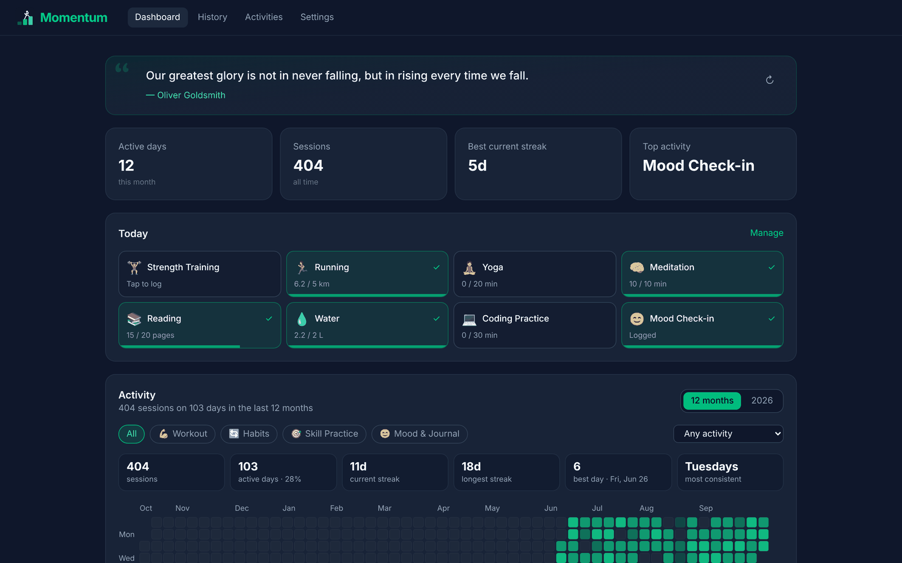

</div>

---

## Why Momentum?

Most trackers are built around the streak. Miss one day and the number resets to zero, and the app that was supposed to motivate you now tells you that you failed. Plenty of people quit right there.

Momentum is built on a different idea: **progress is the pile of days you showed up, not the days you didn't.** Each logged session is a block, and you stack the blocks one at a time. The logo shows exactly that: someone climbing a staircase of their own blocks.

### The philosophy

1. **Consistency beats intensity.** Ten minutes, logged, beats an hour you only planned. Logging takes one or two taps, so the friction never wins.
2. **Forgive the gaps.** Streaks are celebrated, but they aren't the only measure. Activities you do a few times a week earn **weekly streaks** ("17 weeks in a row"), and the dashboard tracks your consistency over the last 7 days, so one missed day never wipes out months of work.
3. **Make effort visible.** A year of blocks on a heatmap, lifetime totals turned into something tangible ("194 km ≈ 4.6 marathons", "16 h ≈ 8 feature-length movies"), and milestones that are always within reach.
4. **Celebrate automatically.** Personal records are detected for you: heaviest set, estimated 1RM, longest run, biggest session. You'll know you beat your best the moment you log it.
5. **Learn what actually helps.** Daily mood check-ins, combined with everything else you log, show patterns like *"on days after a workout, your mood is 1.4 pts higher."*
6. **Your data is yours.** Only your account can read your logs, and nobody gets to look at them, ads or analytics included. There's no premium tier and no upsell.

---

## A tour

### Start in under a minute

Pick what you want to build up from a curated set of activities across four areas (Workout, Habits, Skill Practice, Mood & Journal), or create your own.

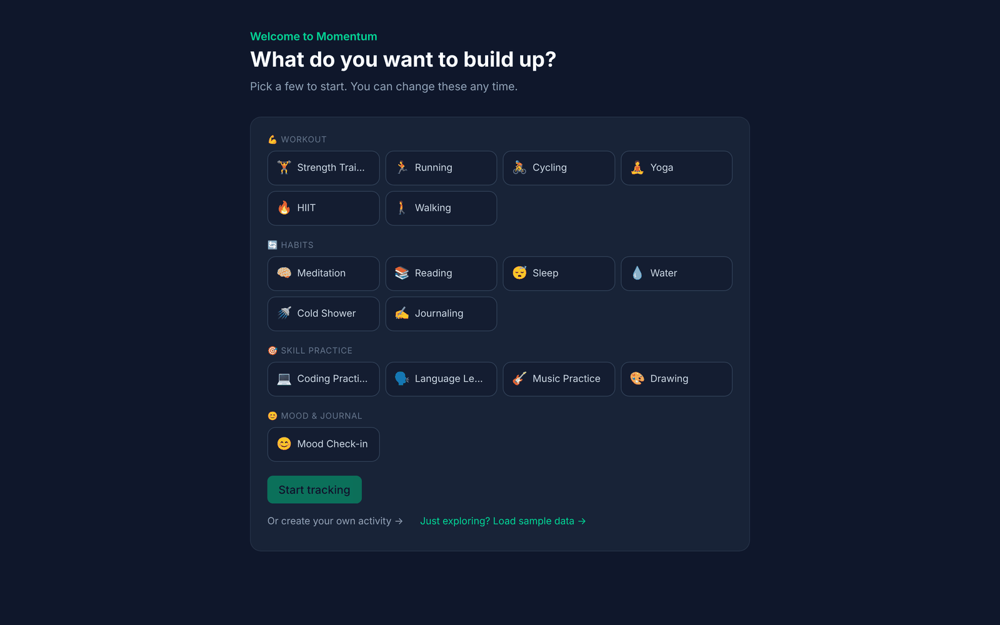

### Your day at a glance

The dashboard opens with a fresh motivational quote and a **Today** board. Each tile shows progress toward that activity's daily goal (6.2 / 5 km, 15 / 20 pages), fills up as you go, and turns green when you're done. Yes/no habits are a single tap.

### The heatmap: a year of showing up

Every day is a block, and the more you did, the brighter it glows. Switch between the last 12 months and past years, filter by category or by a single activity (the grid recolors to match), and read the insight strip: sessions, active days, current and longest streak, best day, and your most consistent weekday. Today is outlined.

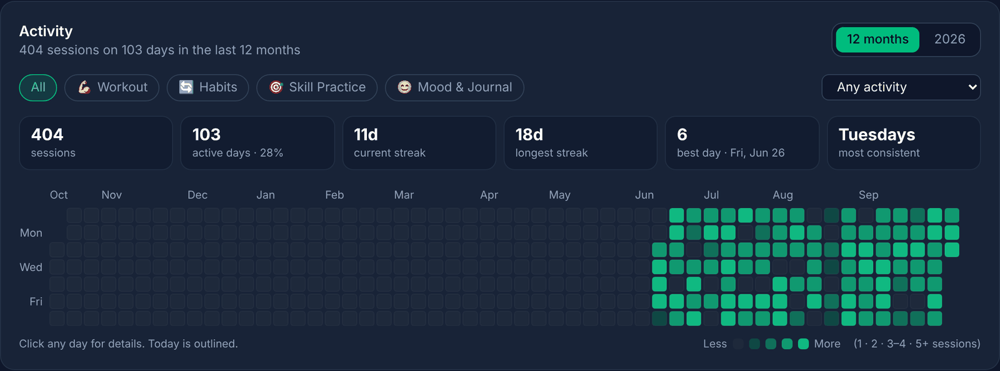

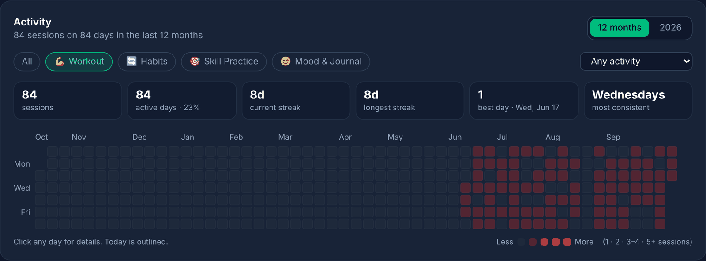

### Click any day to relive it

Tap a block to see everything you did that day: sessions, active minutes, mood, records set, notes. Edit or delete entries, step to the previous or next day, or backfill something you forgot to log.

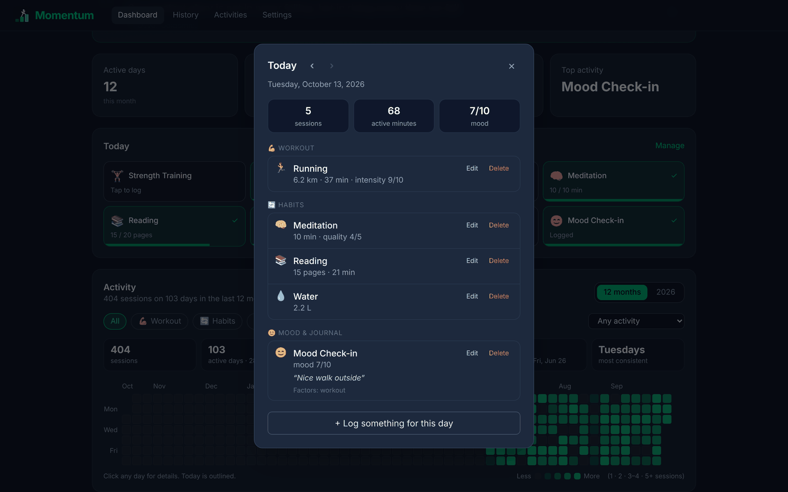

### Logging that fits the activity

The log form adapts to what you're tracking. Strength sessions get **sets × reps × weight** with live volume; runs get distance and time; skills get difficulty; habits get quality. Everything shows up in your preferred units.

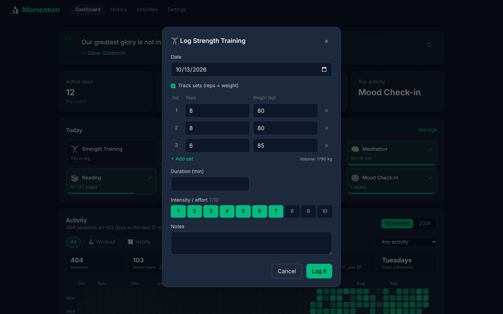

### Mood check-ins that mean something

A check-in asks how you feel (it's never pre-filled), plus optional energy, stress, contributing factors and a gratitude journal. After 14 days of check-ins, Momentum starts showing which activities lift your mood.

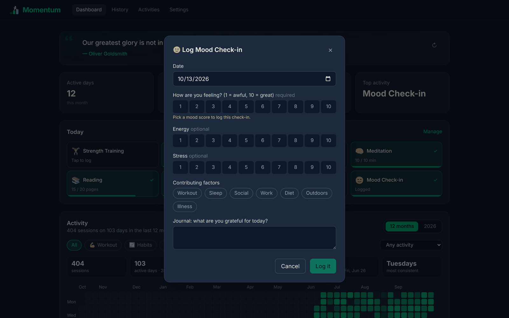

### Activities that cheer you on

Each activity card gives a personal, data-driven nudge ("4-day streak and today's done. Momentum looks good on you."), a 12-week sparkline, lifetime totals with fun comparisons, your top record, and a progress bar to the next milestone (5 → 10 → 25 → 50 → 100 … 5,000 sessions).

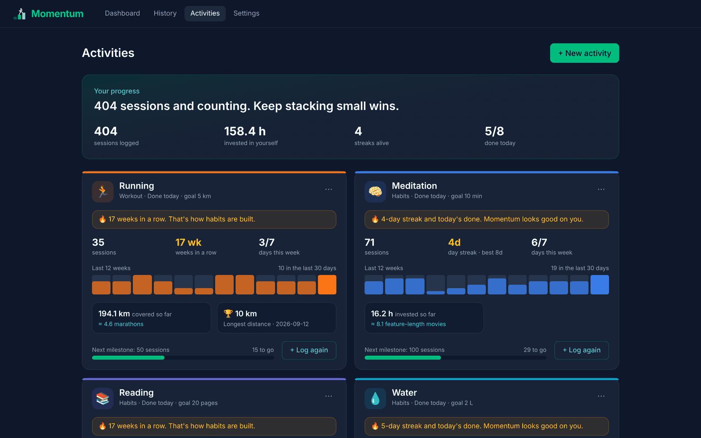

### Make it yours

Create custom activities with a searchable emoji picker that suggests icons from the name you type, choose a color, a unit, and a daily goal.

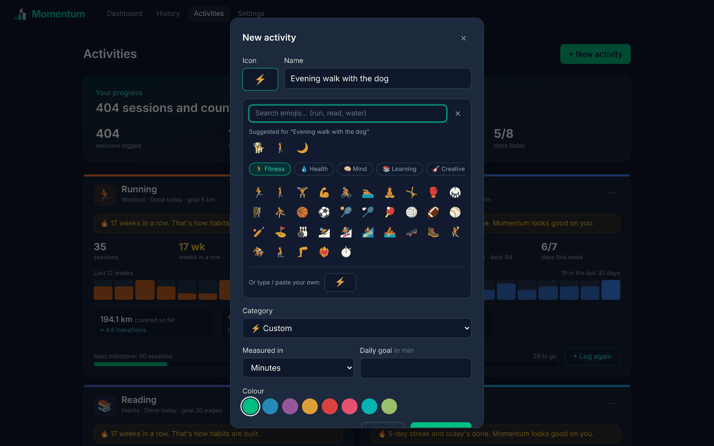

### Every entry, searchable

History lists everything, grouped by day and filterable by category, activity and date range.

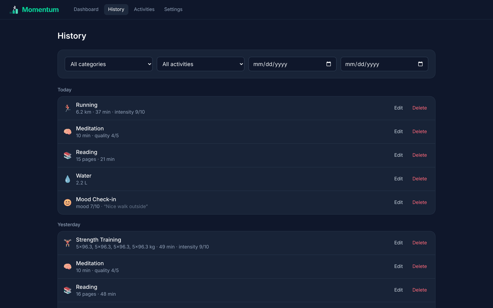

### Settings, light mode and email nudges

Light / dark / system theme; kg or lb, km or mi, L or fl oz; week start; a searchable time-zone picker; and optional emails: a **daily reminder** at the hour you pick (only sent if you haven't logged anything yet) and a **Sunday weekly summary**. In the iPhone app, **log reminders** arrive at 3 PM, 7 PM and 10 PM, and stop for the day once everything's logged.

<p>
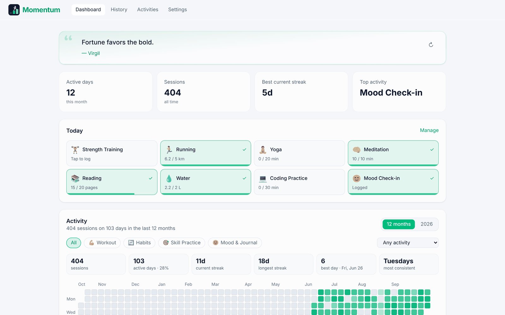
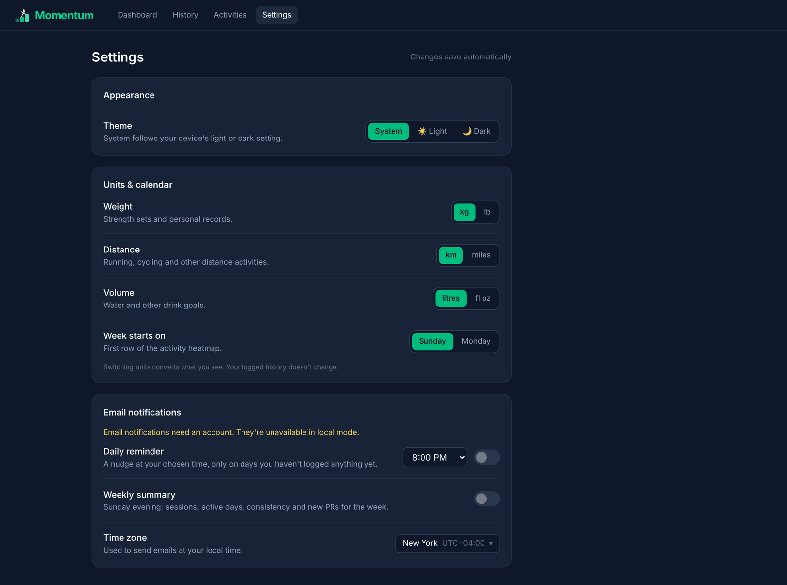
</p>

### Built for your phone

It's a fully responsive, installable PWA: add it to your home screen from the browser menu and it opens full-screen like a native app.

<p>
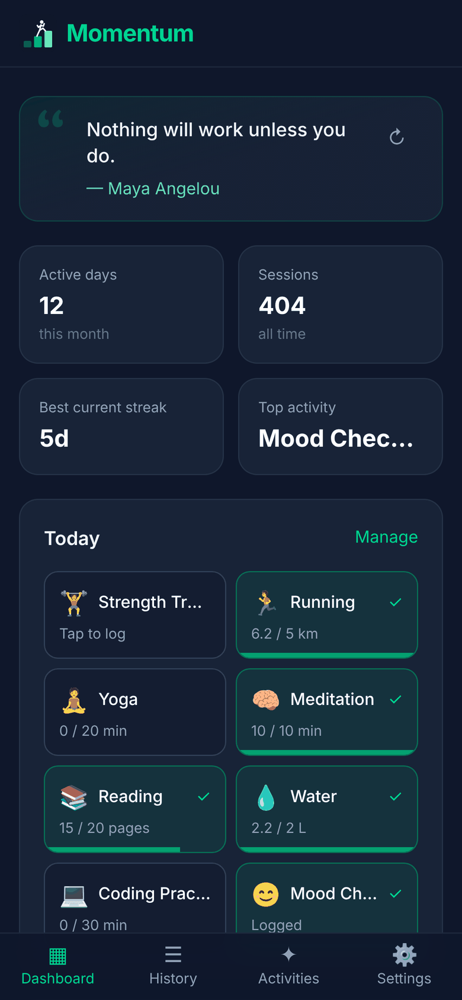
&nbsp;
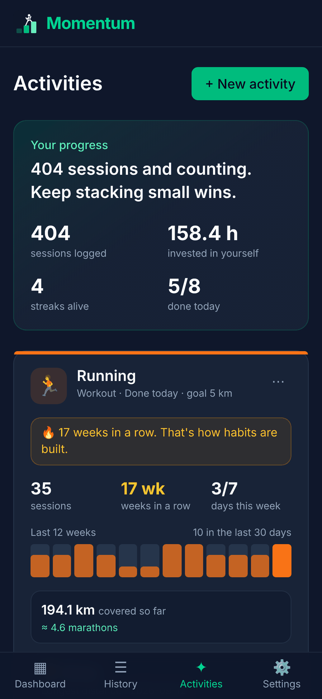
</p>

---

## How it works

```
 ┌────────────────────────────┐       HTTPS (supabase-js)       ┌──────────────────────────────┐
 │  React PWA (GitHub Pages)  │ ──────────────────────────────▶ │  Supabase                    │
 │  momentum.praveendhra.com  │ ◀────────────────────────────── │  • Auth (email, Google)      │
 │                            │     only *your* rows, via RLS    │  • Postgres + row-level sec. │
 │  • all stats computed here │                                  │  • pg_cron → Edge Function   │
 └────────────────────────────┘                                  │      └─▶ Resend (emails)     │
                                                                 └──────────────────────────────┘
```

- **No app server.** The browser talks to Supabase directly with the public (publishable) key. **Row-level security** policies in `supabase/schema.sql` guarantee each user can only read and write their own rows, so the key being public is safe by design.
- **Stats run in the browser.** Heatmap, streaks (daily and weekly), personal records, milestones and mood correlations are computed client-side from your logs (`frontend/src/lib/stats.ts`, `activityStats.ts`, `heatmap.ts`). That keeps the database simple and the app fast.
- **Metric under the hood.** Everything is stored in metric; your unit preferences only change what you see and type (`lib/units.ts`).
- **Phone reminders.** The iOS app schedules local notifications (`@capacitor/local-notifications`, `frontend/src/lib/reminders.ts`) for 3 PM, 7 PM and 10 PM a week ahead, and reschedules them whenever the app opens or a log changes. No push server or APNs key is involved.
- **Emails.** An hourly `pg_cron` job calls the `send-notifications` Edge Function, which sends due reminders and summaries through Resend. A `notification_log` table makes sure each email goes out at most once.
- **Free to run.** GitHub Pages + Supabase free tier + Resend free tier.

| Layer | Tech |
|---|---|
| Frontend | React 19, TypeScript, Vite, Tailwind CSS v4, TanStack Query, react-activity-calendar, vite-plugin-pwa |
| Backend | Supabase (Postgres, Auth, Edge Functions, pg_cron, pg_net) |
| Email | Resend, sending from `mail.praveendhra.com` |
| Hosting / CI | GitHub Pages, deployed by GitHub Actions on every push to `main` |

---

## Developer guide

### Run locally

```bash
cd frontend
npm install
cp .env.example .env.local   # fill in the Supabase URL + publishable key, or leave blank
npm run dev
```

Without Supabase values the app runs in **local mode**: no sign-in, data saved in that browser's localStorage. Handy for UI work (the screenshots above were taken this way, with sample data).

### Deploy

Push to `main`. `.github/workflows/deploy-pages.yml` builds the frontend and publishes it to GitHub Pages with the `momentum.praveendhra.com` CNAME. Supabase settings come from repository secrets/variables.

### iOS app (App Store)

The app is also packaged for iPhone with Capacitor (`frontend/ios/`, bundle ID `com.praveendhra.momentum`). GitHub Actions builds it on macOS and uploads it to TestFlight (`.github/workflows/ios-release.yml`); no Mac needed. One-time setup, store listing text, privacy answers and screenshots: **[docs/app-store.md](docs/app-store.md)**. Locally, `npm run ios:sync` builds the web app without the service worker and copies it into the iOS project.

### Database changes

`supabase/schema.sql` is the source of truth and is safe to re-run. Paste it into Supabase → SQL Editor → Run after editing it.

### Email notifications

- `supabase/functions/send-notifications`: Edge Function for the daily reminder and the Sunday 7 pm weekly summary, via [Resend](https://resend.com).
- `supabase/cron.sql`: hourly `pg_cron` job that calls the function.
- Secrets (Supabase → Edge Functions → Secrets): `RESEND_API_KEY` and `RESEND_FROM` (currently `Momentum <momentum@mail.praveendhra.com>`).
- Sending domain `mail.praveendhra.com` is verified in Resend via a DKIM TXT record and two CNAMEs (`rsend.mail`, `send.mail`, DNS only) in Cloudflare.
- The function's "Verify JWT with legacy secret" setting must be **off** (the function authenticates test-email requests itself).
- **Sender avatar:** `momentum@mail.praveendhra.com` is also a Google account with the Momentum logo as its profile photo, so Gmail shows the logo next to Momentum emails. Mail to that address is forwarded to the owner's Gmail by Cloudflare Email Routing (subdomain `mail.praveendhra.com`).
- Redeploy after editing: paste `index.ts` into the function's Code tab in the dashboard, or `supabase functions deploy send-notifications --no-verify-jwt`.

### Social sign-in

**Google is live.** OAuth client "Momentum web (Supabase)" lives in the Google Cloud project `momentum-511514` (Google Auth Platform → Clients), with `https://momentum.praveendhra.com` as the JavaScript origin and `https://qcyijvnkgdznekbzccgj.supabase.co/auth/v1/callback` as the redirect URI. Its client ID and secret are saved in Supabase → Authentication → Sign In / Providers → Google.

The button skips Supabase's OAuth redirect (`frontend/src/lib/googleAuth.ts`): it sends you to Google with `redirect_uri=https://momentum.praveendhra.com/` and `response_type=id_token`, then exchanges the returned ID token with `supabase.auth.signInWithIdToken` (hashed nonce + `state` check). That's why Google's screen says "to continue to momentum.praveendhra.com" rather than the `*.supabase.co` project URL (the alternative, a Supabase custom domain, needs a paid plan). Both `https://momentum.praveendhra.com/` and the Supabase callback are registered as redirect URIs on the Google client; the public client ID is set via `VITE_GOOGLE_CLIENT_ID` in the deploy workflow.

To add **GitHub** (or another provider):

1. Create an OAuth app (GitHub → Settings → Developer settings → OAuth Apps) with the Supabase callback URL above, then enable GitHub in Supabase with its client ID/secret.
2. GitHub repo → Settings → Secrets and variables → Actions → Variables → set `VITE_AUTH_PROVIDERS` = `google,github` (the deploy defaults to `google`).
3. Re-run the "Deploy frontend to GitHub Pages" workflow.

### Project layout

```
frontend/          React PWA (the app)
  src/pages/       Dashboard, History, Activities, Settings, Auth, Onboarding
  src/components/  Heatmap, log + day-detail modals, activity cards, emoji picker…
  src/lib/         stats, heatmap, units, preferences, quotes
supabase/          schema.sql, cron.sql, Edge Function for emails
backend/           optional FastAPI service (not used by the live deployment)
docs/screenshots/  images used in this README
```

### `backend/` (optional)

The original FastAPI service is still here (`docker compose up`, then `alembic upgrade head`). It's a working, self-hostable alternative API with the same logic, but the GitHub Pages deployment doesn't use it.

---

<div align="center">

Built by **Praveendhra Rajkumar**. Start stacking your blocks at **[momentum.praveendhra.com](https://momentum.praveendhra.com)**.

</div>
